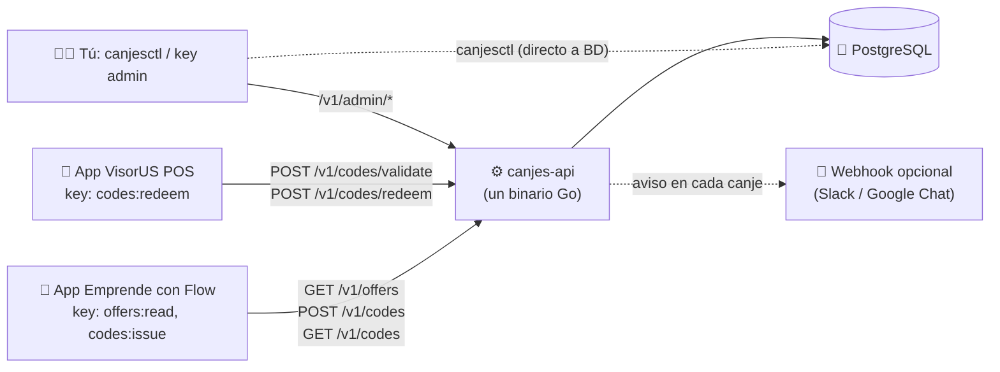
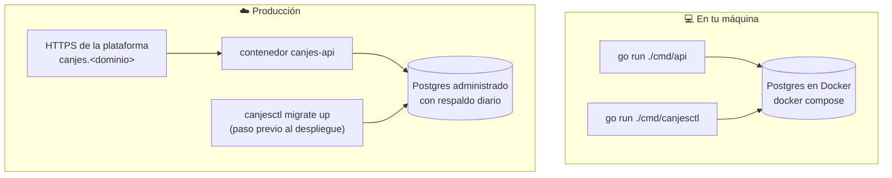
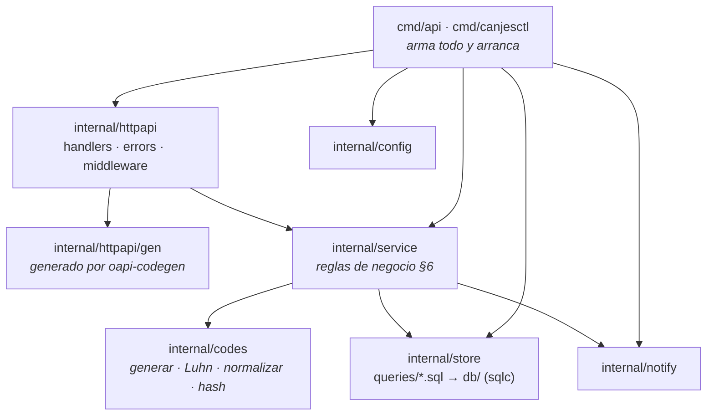
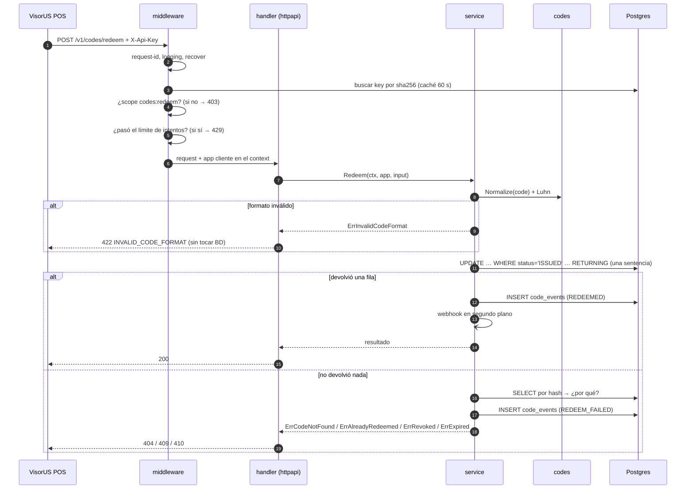
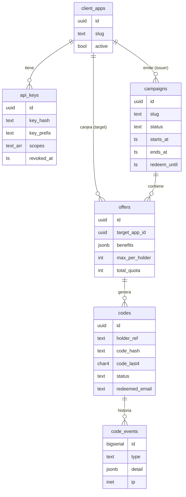
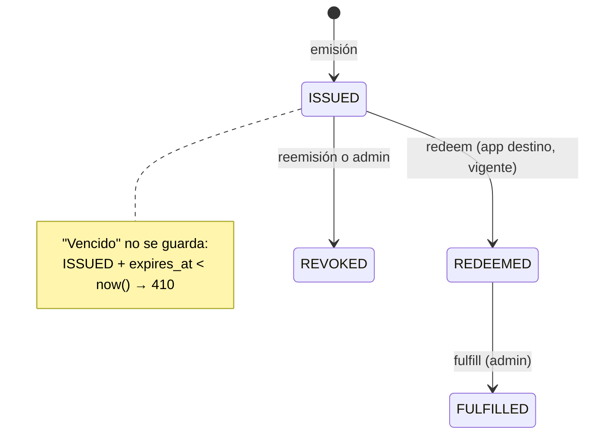
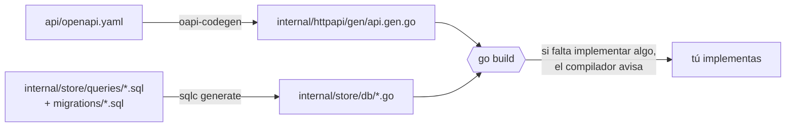

# Arquitectura — `canjes-api`

> Traduce [`SYSTEM_DESIGN.md`](./SYSTEM_DESIGN.md) (la fuente de verdad) a paquetes, capas y flujos concretos de Go. Si este documento y el SD no coinciden, **gana el SD** y este documento se corrige.

---

## 0. En una frase (para cualquier persona)

`canjes-api` es una **taquilla de boletos**: una app (Emprende con Flow) pide boletos únicos de 40 dígitos, otra app (VisorUS POS) los recibe y los marca como usados con el correo de la persona, y tú tienes la libreta donde consta quién recibió qué y cuándo. La taquilla nunca guarda el boleto completo, solo su "huella" (hash), así que aunque alguien vea la libreta, no puede falsificar boletos.

---

## 1. Contexto



- La API **no conoce puntos ni saldos** (D15). Solo garantiza que el código es único, de un solo uso y trazable.
- La API **nunca recibe nombre ni correo** de la app emisora: solo `holderRef`, un identificador opaco. El correo llega desde la app destino, con consentimiento (§1.2).

---

## 2. Piezas desplegables

| Pieza | Qué es | Dónde vive |
|---|---|---|
| `canjes-api` | Servidor HTTP. Un solo proceso, sin estado salvo el límite de intentos en memoria. | `cmd/api/main.go` → imagen Docker distroless |
| `canjesctl` | CLI de administración: migraciones, alta de apps, keys, campañas y ofertas. Habla **directo con Postgres**. | `cmd/canjesctl/main.go` → mismo contenedor o tu máquina |
| PostgreSQL | Toda la verdad del sistema: catálogo, códigos, bitácora. | Docker en local; Postgres administrado en producción |



---

## 3. Capas y regla de dependencias



**Regla (§7.2):** `httpapi → service → store`, y `codes` no depende de nadie.

| Paquete | Responsabilidad | Puede importar | **No** puede |
|---|---|---|---|
| `internal/config` | Leer y validar variables de entorno; valores por defecto. | stdlib | Leer variables fuera de este paquete |
| `internal/codes` | Generar códigos (`crypto/rand` + Luhn), `Normalize`, `Hash`, `Display` (grupos de 4), `MaskEmail`, `GenerateAPIKey`. Funciones puras. | stdlib | Tocar BD, HTTP o logs |
| `internal/store` | SQL escrito a mano (`queries/*.sql`) y el código Go que genera `sqlc` (`db/`). Abre el `pgxpool`. | `pgx/v5` | Tener reglas de negocio |
| `internal/service` | Emisión (§6.2), validación (§6.4), canje (§6.3), admin. Define los **errores de dominio**. Abre y cierra transacciones. | `store`, `codes`, `notify` | Conocer `http.Request`, códigos HTTP o JSON |
| `internal/httpapi` | Implementa la interfaz generada por `oapi-codegen`, traduce errores de dominio a `{error, message}` + estado HTTP, CSV. | `gen`, `service` | Escribir SQL |
| `internal/httpapi/middleware` | request-id, logging, recover, auth (API key + scope), rate-limit. | `store` (solo para buscar keys, vía interfaz `KeyStore`) | Lógica de códigos |
| `internal/notify` | Webhook en segundo plano con timeout de 3 s, sin reintentos. | stdlib | Bloquear la respuesta del canje |
| `cmd/api` | Cablea dependencias (inyección **manual** por constructores), arranca el servidor y lo apaga ordenadamente. | todo `internal/` | Tener lógica |
| `cmd/canjesctl` | Subcomandos: `migrate`, `apps`, `keys`, `campaigns`, `offers`. | `store`, `codes`, `config`, `migrations` | Pasar por HTTP |

**Por qué así:** cada capa se puede entender sola. Si mañana el contrato HTTP cambia, el servicio no se toca; si mañana se cambia Postgres por otro motor (improbable), los handlers no se tocan.

**Interfaces:** se declaran **donde se consumen** y solo cuando hacen falta (por ejemplo `KeyStore` en el middleware, para poder envolverla con una caché de 60 s). El servicio usa los tipos concretos de `store`, porque sus reglas se prueban contra Postgres real (§7.4).

---

## 4. Árbol del repositorio

```
canjes-api/
├── api/openapi.yaml                 ← contrato (D2) — se edita a mano
├── cmd/
│   ├── api/main.go                  ← servidor
│   └── canjesctl/main.go            ← CLI
├── internal/
│   ├── config/config.go
│   ├── codes/                       ← codes.go, luhn.go, codes_test.go, fuzz_test.go
│   ├── service/                     ← service.go, errors.go, offers.go, issue.go, validate.go, redeem.go, admin.go
│   ├── httpapi/
│   │   ├── gen/api.gen.go           ← generado (no editar)
│   │   ├── server.go                ← router + middlewares
│   │   ├── handlers.go              ← implementa gen.StrictServerInterface
│   │   ├── errors.go                ← error de dominio → HTTP
│   │   └── middleware/              ← requestid.go, logging.go, recover.go, auth.go, ratelimit.go
│   ├── store/
│   │   ├── store.go                 ← abre pgxpool, helper de transacciones
│   │   ├── queries/*.sql            ← SQL a mano
│   │   └── db/*.go                  ← generado por sqlc (no editar)
│   └── notify/webhook.go
├── migrations/                      ← 00001_init.sql + embed.go (para incrustarlas en canjesctl)
├── seeds/ecf-piloto-2026-10.sql
├── test/integration/                ← pruebas con testcontainers (etiqueta integration)
├── docs/                            ← SYSTEM_DESIGN, ARCHITECTURE, SKILLS, APRENDIZAJE, playbooks/
├── Dockerfile · docker-compose.yml · Makefile
├── sqlc.yaml · oapi-codegen.yaml · .golangci.yml · .env.example
└── go.mod · go.sum
```

---

## 5. Recorrido de una petición

Ejemplo: VisorUS POS canjea un código.



---

## 6. Dónde vive cada decisión del SD

| Decisión | Dónde se implementa | Playbook |
|---|---|---|
| D1 Go + Postgres, un binario | `cmd/api`, `Dockerfile` | 01, 13 |
| D2 Contrato primero | `api/openapi.yaml`, `oapi-codegen.yaml`, `internal/httpapi/gen` | 02 |
| D3 SQL a mano + sqlc | `internal/store/queries`, `sqlc.yaml` | 03 |
| D4 Keys con scopes | `api_keys.scopes`, `middleware/auth.go`, `canjesctl keys` | 06, 07 |
| D5 40 dígitos + Luhn | `internal/codes` | 04 |
| D6 Solo hash + last4 | `codes.Hash`, columnas `code_hash`, `code_last4` | 04, 08 |
| D7 Un código vigente; reemitir revoca | índice `ux_codes_one_active` + paso 5 de §6.2 | 03, 08 |
| D8 Canje en una sentencia | query `RedeemCode` | 03, 09 |
| D9 Solo en la app destino | `o.target_app_id = @app_id` en `RedeemCode`; 404 si no | 09 |
| D10 Un correo por oferta | índice `ux_codes_email_per_offer`; error `23505` → 409 | 03, 09 |
| D11 Bitácora que solo crece | tabla `code_events`, solo `INSERT` | 03, 08–11 |
| D12 Rutas `/v1` | `openapi.yaml` | 02 |
| D13 Formato de errores | `internal/httpapi/errors.go` | 05, 08 |
| D14 CLI en vez de panel | `cmd/canjesctl` | 06 |
| D15 La API no sabe de puntos | (ausencia deliberada) | — |

---

## 7. Datos



El SQL completo está en SD §4 y se copia **tal cual** en `migrations/00001_init.sql`.

### Máquina de estados del código



---

## 8. Errores: del dominio al HTTP

El servicio devuelve **errores de dominio** (variables `Err…` en `internal/service/errors.go`) y no sabe de HTTP. Un único lugar, `internal/httpapi/errors.go`, los traduce:

| Error de dominio | HTTP | `error` |
|---|:---:|---|
| `ErrValidation` | 422 | `VALIDATION_ERROR` |
| `ErrInvalidCodeFormat` | 422 | `INVALID_CODE_FORMAT` |
| `ErrOfferNotFound` | 404 | `OFFER_NOT_FOUND` |
| `ErrCodeNotFound` | 404 | `CODE_NOT_FOUND` |
| `ErrCampaignNotActive` | 410 | `CAMPAIGN_NOT_ACTIVE` |
| `ErrCodeRevoked` | 410 | `CODE_REVOKED` |
| `ErrCodeExpired` | 410 | `CODE_EXPIRED` |
| `ErrHolderLimitReached` | 409 | `HOLDER_LIMIT_REACHED` |
| `ErrOfferSoldOut` | 409 | `OFFER_SOLD_OUT` |
| `ErrCodeAlreadyRedeemed` | 409 | `CODE_ALREADY_REDEEMED` |
| `ErrEmailAlreadyRedeemed` | 409 | `EMAIL_ALREADY_REDEEMED` |
| `ErrInvalidTransition` | 409 | `INVALID_STATE` (fulfill/revoke admin sobre un estado que no lo permite) |
| (middleware) sin key / key inválida | 401 | `UNAUTHORIZED` |
| (middleware) sin scope | 403 | `FORBIDDEN` |
| (middleware) límite | 429 | `TOO_MANY_ATTEMPTS` |
| cualquier otro | 500 | `INTERNAL_ERROR` (se registra en log con `request_id`; nunca se expone el detalle) |

Los `message` en español salen de la tabla de SD §5.2.

> `INVALID_STATE` no está en el SD; es la respuesta propuesta para `fulfill`/`revoke` sobre un código en un estado que no admite esa transición (§3.1). Confírmalo y agrégalo al SD en el playbook 11.

---

## 9. Concurrencia y consistencia

| Riesgo | Mecanismo | Dónde |
|---|---|---|
| Dos canjes del mismo código al mismo tiempo | `UPDATE … WHERE status='ISSUED' RETURNING`: Postgres deja ganar a uno; el otro ve 0 filas → 409 | `RedeemCode` (§6.3) |
| Dos emisiones que superan el cupo | Transacción + `SELECT … FOR UPDATE OF o` serializa emisiones **de esa oferta** | `LockOfferForIssue` (§6.2) |
| Dos códigos vigentes para la misma persona y oferta | Índice único parcial `ux_codes_one_active` | migración |
| Un correo canjea dos veces la misma oferta | Índice único parcial `ux_codes_email_per_offer` | migración |
| Colisión de hash al generar | Reintentar hasta 3 veces si el `INSERT` choca con `code_hash` | servicio de emisión |

**No hay mutex en Go para nada de esto.** El único estado en memoria es el límite de intentos (`x/time/rate`) y la caché de keys; con dos instancias, el límite pasa a ser "por instancia" (aceptado en §8).

---

## 10. Seguridad (resumen operativo)

- **Keys:** formato `ck_live_<32 aleatorios>`; en BD solo `sha256(key)` y un prefijo para reconocerla en logs. Se muestran una vez al crearlas.
- **Códigos:** 39 dígitos de `crypto/rand` (~129 bits) + Luhn. En BD solo `sha256` + últimos 4.
- **Logs:** nunca el código completo, la key ni el correo completo. Correo enmascarado como `u***@gmail.com`.
- **Límite de intentos:** 10 fallos/min por (key, IP) en `validate`/`redeem`; 30/min por key en emisión.
- **TLS:** lo da la plataforma de despliegue. La API escucha HTTP plano dentro del contenedor.
- **IP real:** detrás de un balanceador, la IP del cliente viene en `X-Forwarded-For`. Solo se confía en ese encabezado si la plataforma lo garantiza (playbook 10).

---

## 11. Ciclo de vida del proceso

1. `config.Load()` lee variables de entorno; si falta `DATABASE_URL`, el proceso sale con error claro.
2. Se crea el `slog.Logger` JSON con el nivel de `LOG_LEVEL`.
3. Se abre `pgxpool` y se hace `Ping`.
4. Se construyen, en orden: `store` → `notify` → `service` → `httpapi` (handlers + middlewares).
5. `http.Server` con timeouts (`ReadHeaderTimeout`, `ReadTimeout`, `WriteTimeout`, `IdleTimeout`).
6. Al recibir `SIGTERM`/`SIGINT`: `server.Shutdown(ctx)` con 10 s de gracia, luego `pool.Close()`.

`/healthz` responde 200 si el proceso vive; `/readyz` hace `Ping` a Postgres.

---

## 12. Generación de código



`make generate` corre ambos. Los archivos generados **sí se versionan** en git (así el build no depende de tener las herramientas instaladas) y **nunca se editan a mano**.

---

## 13. Estrategia de pruebas

| Nivel | Qué | Cómo se corre |
|---|---|---|
| Unitarias | `codes` (generar, Luhn, normalizar, hash), mapeo de errores, config | `make test` (sin Docker) |
| Fuzz | `codes.Normalize` nunca entra en pánico y nunca acepta algo que no sean 40 dígitos con Luhn válido | `go test -fuzz=FuzzNormalize ./internal/codes` |
| Integración | Cada regla de §6 y cada casilla del *Definition of Done* contra Postgres real | `make test-int` (Docker + testcontainers, etiqueta `integration`) |
| Concurrencia | 20 canjes simultáneos → 1 éxito; 20 emisiones contra cupo 5 → 5 éxitos | dentro de `make test-int`, con `-race` |
| Contrato | Las respuestas cumplen `openapi.yaml` (`kin-openapi`) | dentro de `make test-int` |

---

## 14. Cómo crece (sin romper la arquitectura)

| Cambio futuro (SD §10) | Toca solo |
|---|---|
| Otra app destino o emisora | Datos (`canjesctl`), nada de código |
| Nuevo tipo de beneficio | Datos (`benefits` es `jsonb`) |
| Código corto alfanumérico | Una función nueva en `internal/codes` + `campaigns.code_format` |
| JWT de la persona en vez de key en la app | Un middleware nuevo |
| Varias instancias | `middleware/ratelimit.go` pasa a Redis |
| Panel web de solo lectura | Nuevo cliente de los endpoints admin; la API no cambia |
