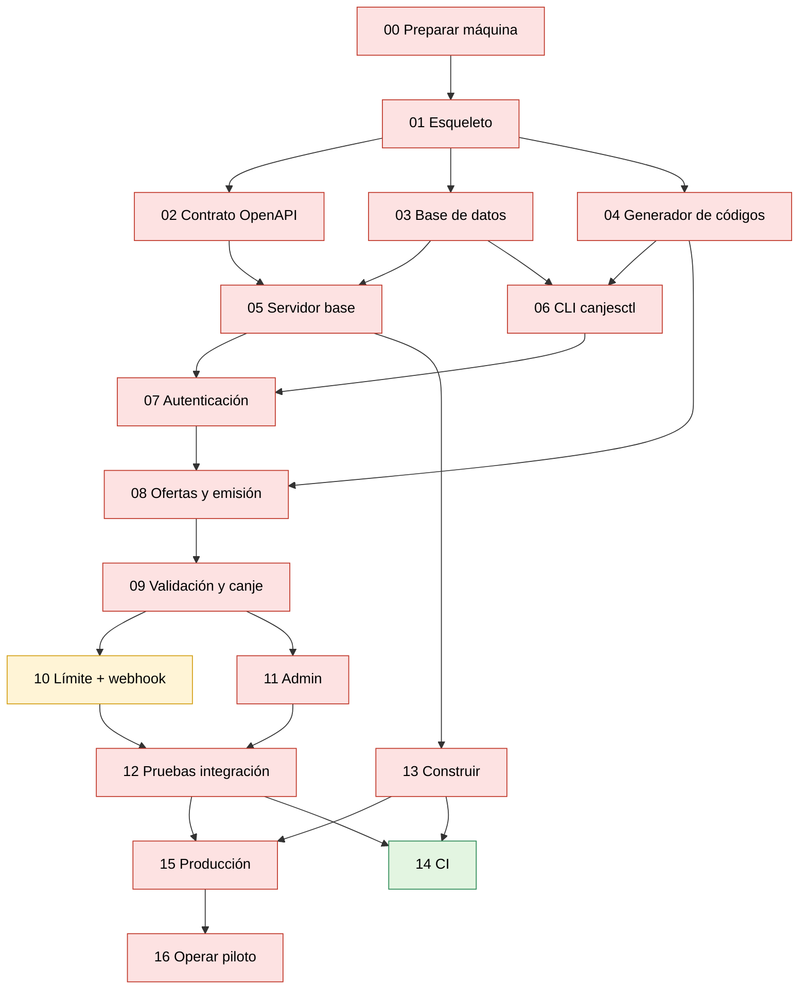

# Playbooks de implementación — `canjes-api`

Cada playbook es un **plan ejecutable** (al estilo `/plan`) para una etapa de la API. Se trabajan **uno a la vez**, en orden, y cada uno termina con algo que funciona y se puede comprobar.

- Fuente de verdad: [`../SYSTEM_DESIGN.md`](../SYSTEM_DESIGN.md)
- Cómo se organiza el código: [`../ARCHITECTURE.md`](../ARCHITECTURE.md)
- Qué skills usa Claude y por qué: [`../SKILLS.md`](../SKILLS.md)
- Qué estudiar de Go: [`../APRENDIZAJE.md`](../APRENDIZAJE.md)

---

## Índice

| # | Playbook | Responde a | Prioridad | Día |
|:-:|---|---|:-:|:-:|
| 00 | [Preparar tu máquina](./00-preparar-entorno.md) | **¿Cómo instalarlo en local?** | 🔴 | 1 |
| 01 | [Esqueleto del proyecto](./01-esqueleto-proyecto.md) | ¿Dónde va cada cosa? | 🔴 | 1 |
| 02 | [Contrato OpenAPI](./02-contrato-openapi.md) | ¿Qué endpoints existen y qué devuelven? | 🔴 | 1 |
| 03 | [Base de datos: migraciones y consultas](./03-base-de-datos.md) | ¿Cómo se guardan los datos? | 🔴 | 1 |
| 04 | [Generador de códigos (Luhn + hash)](./04-generador-codigos.md) | ¿Cómo nace un código de 40 dígitos? | 🔴 | 1 |
| 05 | [Servidor base: config, logs y salud](./05-servidor-base.md) | **¿Cómo ejecutarlo?** | 🔴 | 2 |
| 06 | [CLI `canjesctl` y semilla del piloto](./06-cli-canjesctl.md) | ¿Cómo doy de alta apps, keys y ofertas? | 🔴 | 1–2 |
| 07 | [Autenticación por API key y scopes](./07-autenticacion.md) | ¿Quién puede hacer qué? | 🔴 | 2 |
| 08 | [Ofertas y emisión de códigos](./08-ofertas-y-emision.md) | N1, N2: listar y emitir | 🔴 | 2 |
| 09 | [Validación y canje](./09-validacion-y-canje.md) | N3: validar y canjear | 🔴 | 3 |
| 10 | [Límite de intentos y webhook](./10-limite-intentos-y-webhook.md) | Protección y avisos | 🟡 | 3 |
| 11 | [Endpoints de administración](./11-admin.md) | N4: ver y entregar | 🔴 | 3 |
| 12 | [Pruebas de integración y concurrencia](./12-pruebas-integracion.md) | ¿Cumple el *Definition of Done*? | 🔴 | 4 |
| 13 | [Construir: binarios e imagen Docker](./13-construir.md) | **¿Cómo construir?** | 🔴 | 4 |
| 14 | [Integración continua (GitHub Actions)](./14-integracion-continua.md) | ¿Cómo evito romper algo? | 🟢 | después |
| 15 | [Lanzar a producción](./15-produccion.md) | **¿Cómo lanzarlo a producción?** | 🔴 | 4 |
| 16 | [Operar el piloto](./16-operar-piloto.md) | ¿Qué hago cada día del piloto? | 🔴 | 7–20 oct |

🔴 crítico para el piloto · 🟡 recomendado antes del piloto, puede entrar en la semana del 5 de octubre · 🟢 puede esperar a después del piloto

---

## Orden y dependencias

Una flecha `A → B` significa "**B necesita que A esté terminado**".

**Lo que se puede hacer en paralelo:** 02, 03 y 04 solo dependen de 01. Si alguien del equipo te ayuda, 04 (generador de códigos) es la pieza más aislada y fácil de delegar.

**Pruebas:** cada playbook escribe sus propias pruebas. El 12 no "empieza" las pruebas: completa las de integración, agrega las de concurrencia y comprueba el *Definition of Done* completo.

---

## Calendario propuesto (SD §0.2)

| Día | Fecha | Playbooks | Entregable del SD |
|:-:|---|---|---|
| 1 | jue 1 oct | 00 · 01 · 02 · 03 · 04 · 06 (alta de catálogo) | Repo, contrato, migraciones, generador con pruebas, CLI |
| 2 | vie 2 oct | 05 · 07 · 08 | Auth con scopes, `GET /v1/offers`, `POST /v1/codes`, `GET /v1/codes` |
| 3 | sáb 3 oct | 09 · 10 · 11 | `validate`, `redeem`, admin JSON + CSV, límite de intentos |
| 4 | dom 4 oct | 12 · 13 · 15 | Pruebas de integración, Docker, despliegue, semilla, prueba punta a punta |
| — | lun 5 oct | — | **Sale la versión de Emprende con Flow** que apunta a la API |
| — | 7–20 oct | 16 | Piloto |
| — | después | 14 | CI |

> ### ⚠️ Nota honesta sobre el calendario
> El plan de 4 días del SD supone a alguien que ya escribe Go. Aprendiendo al mismo tiempo, lo realista es que **Claude escriba la mayor parte del código siguiendo cada playbook y tú revises, pruebes y entiendas**. Aun así el margen es corto.
>
> **Si el domingo 4 a mediodía no está desplegado lo crítico (00–09, 11–13, 15), activa el plan B del SD:** la app sale el lunes con el canje local (SD v1.1) y la integración entra en una versión posterior. Decidirlo a tiempo es mejor que publicar algo sin probar.
>
> **Ruta mínima si el tiempo aprieta:** 10 (límite de intentos y webhook) puede desplegarse durante la semana del 5 al 7 de octubre, antes de que empiece el piloto; con 10 personas el riesgo es bajo. El CSV del playbook 11 puede esperar al JSON.

---

## Cómo trabajar cada playbook

1. **Lee primero "Notas para ti" y "Qué estudiar".** 15–30 minutos de contexto ahorran horas de confusión.
2. **Verifica los "Requisitos previos".** Si algo no está, regresa al playbook anterior.
3. **Crea una rama:** `git checkout -b pb-NN-nombre`.
4. **Pídeselo a Claude** con el texto de "Cómo pedírselo a Claude" (abajo de cada playbook). Claude cargará las skills indicadas a través de `/golang-how-to`.
5. **Revisa paso a paso.** Pide explicación de cualquier cosa que no entiendas *antes* de seguir.
6. **Comprueba "Cómo saber que quedó bien".** Si algo no pasa, no avances.
7. **Haz commit**, une la rama a `main` y marca el playbook como hecho en la tabla de abajo.
8. Lee "Próximos pasos".

### Avance

| # | Estado | Fecha | Notas |
|:-:|:-:|---|---|
| 00 | ⬜ | | |
| 01 | ⬜ | | |
| 02 | ⬜ | | |
| 03 | ⬜ | | |
| 04 | ⬜ | | |
| 05 | ⬜ | | |
| 06 | ⬜ | | |
| 07 | ⬜ | | |
| 08 | ⬜ | | |
| 09 | ⬜ | | |
| 10 | ⬜ | | |
| 11 | ⬜ | | |
| 12 | ⬜ | | |
| 13 | ⬜ | | |
| 14 | ⬜ | | |
| 15 | ⬜ | | |
| 16 | ⬜ | | |

⬜ pendiente · 🟦 en curso · ✅ hecho

---

## Estructura de cada playbook

| Sección | Para qué |
|---|---|
| Ficha (tabla inicial) | Objetivo, prioridad, día, dependencias, secciones del SD, tiempo |
| **Notas para ti** | Qué se construye y por qué importa, en lenguaje no técnico |
| **Qué estudiar** | Lo mínimo de Go/SQL/infra para entender este playbook |
| **Requisitos previos** | Lo que debe existir antes de empezar |
| **Skills a utilizar** | Qué skills de `cc-skills-golang` cargar y para qué |
| **Plan** | Pasos concretos, archivos que se crean y decisiones |
| **Cómo saber que quedó bien** | Comprobaciones con comandos y resultados esperados |
| **Errores comunes** | Lo que suele fallar y cómo resolverlo |
| **Cómo pedírselo a Claude** | Texto listo para copiar |
| **Próximos pasos** | Qué sigue y qué queda pendiente |
